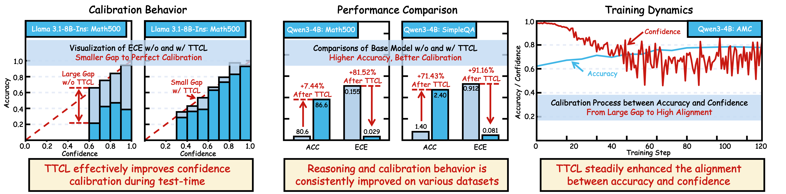
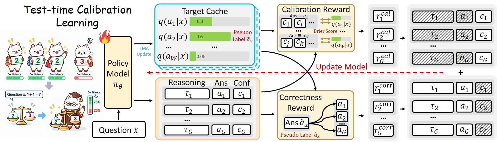
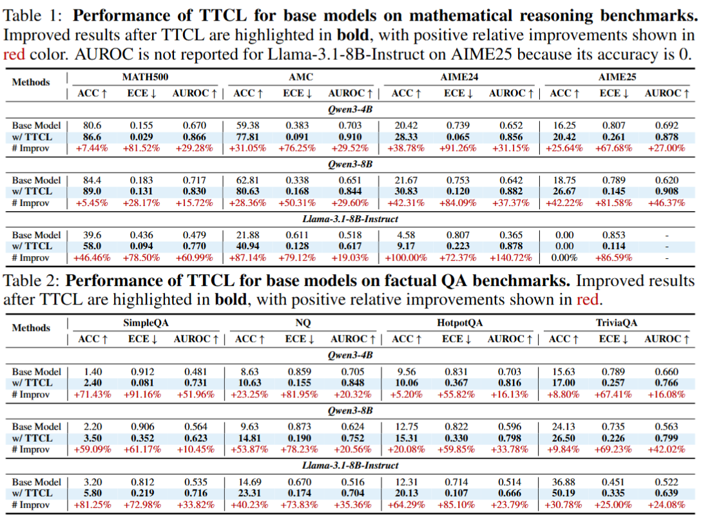
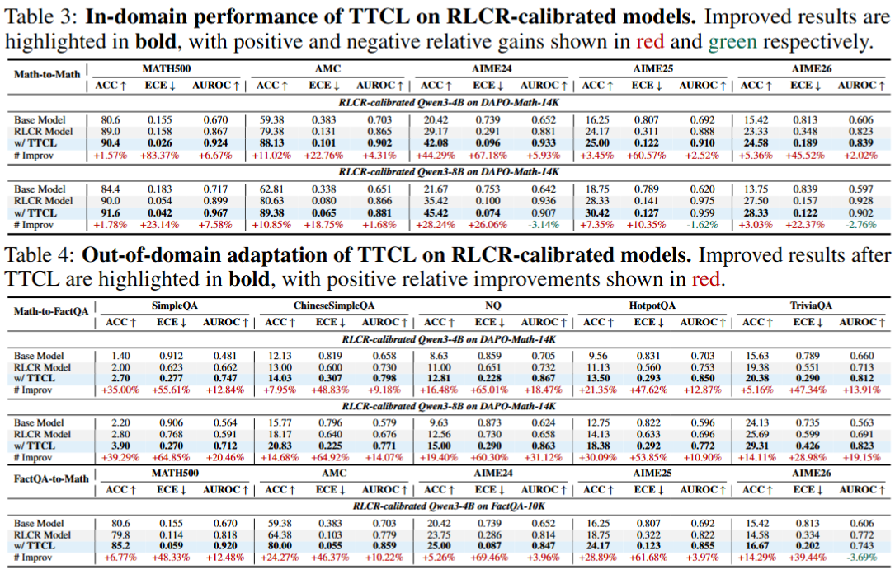
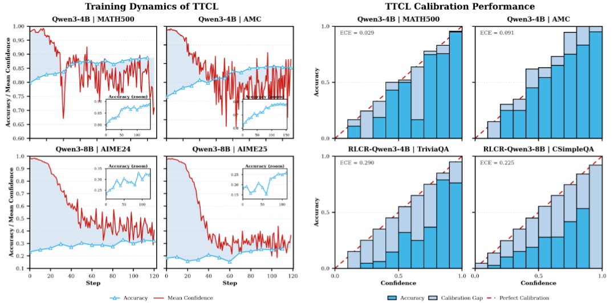

<h1 align="center"><b>Test-time Calibration Learning for Large Language Model Reasoning</b></h1>

**Test-Time Calibration Learning (TTCL)**, a label-free framework that jointly adapts reasoning accuracy and verbalized confidence directly on unlabeled target-task data. Specifically, TTCL derives self-supervision signals for both correctness and calibration from multiple model-generated responses, enabling calibration learning at test time without ground-truth labels. Theoretical analysis further establishes TTCL as a bounded surrogate for the ideal calibration objective. Extensive experiments on mathematical reasoning and factual question answering demonstrate that TTCL consistently improves both accuracy and calibration across diverse models and tasks. On base models, TTCL achieves an average relative accuracy improvement of $+40.13\%$ and an ECE reduction of $+70.80\%$ across eight benchmarks. Moreover, TTCL can further improve both accuracy and calibration for already calibrated models under domain shift, particularly when source-domain calibration transfers poorly to target tasks. In the math-to-factQA setting, TTCL achieves an average relative accuracy gain of $+20.35\%$ and reduces ECE by $+53.83\%$.

## Overview



**Overview of our work:** TTCL enables label-free calibration learning directly on unlabeled target-task data, consistently improving reasoning accuracy while reducing calibration error across models and tasks, with confidence progressively aligning with accuracy during test-time learning.

## Method



**Illustration of TTCL method:** Given an unlabeled question, TTCL samples multiple rollouts to construct label-free supervision: the most supported answer serves as the pseudo label, while the support of each answer provides its confidence target. A target cache stabilizes these signals and is updated via EMA across epochs. Correctness and calibration rewards are optimized separately, with the former updating reasoning and answer tokens and the latter updating only confidence tokens.

## Results





## Visualization of Calibration Performance and Training dynamics of TTCL



**TTCL effectively aligns confidence with empirical accuracy.** Left figure shows the evolution of accuracy and mean confidence during TTCL training. The initial models are generally over-confident, with mean confidence exceeding empirical accuracy. As training proceeds, TTCL narrows this gap while improving accuracy, bringing the two increasingly into alignment. This training behavior empirically supports our theoretical interpretation of TTCL as a surrogate for the ideal calibration objective.

**TTCL effectively aligns confidence with empirical accuracy.** Beyond the scalar ECE metric, Fig.~\ref{Fig:calibration_bar} visualizes confidence against empirical accuracy. Accuracy across confidence bins becomes closer to the ideal calibration diagonal after TTCL, indicating better alignment between predicted confidence and correctness likelihood. This pattern holds across mathematical reasoning and factual QA, as well as base and pre-calibrated models, showing that reliable confidence estimates of TTCL.

## Setup

Create a Python environment with a PyTorch/CUDA version appropriate for your
hardware, activate it, and install the project dependencies with:

```bash
USE_MEGATRON=0 USE_SGLANG=0 bash scripts/install_vllm_sglang_mcore.sh
```

As we use `vllm` as inference engine and `fsdp` as training backbone, we do not need to install `sglang` and `megatron`.

The training and evaluation scripts require a local Hugging Face model
checkpoint.

## Data and models

Datasets are located in `data/`. Set every model path in the launch scripts to
a local checkpoint directory before running an experiment.

## Train TTCL

The TTCL training launcher is:

```bash
bash scripts/majority_ttcl/run.sh
```

This launcher runs the listed experiments serially. Configure `LLM_PATH`,
`MODEL_NAME`, and the experiment list in `scripts/majority_ttcl/run.sh` before
launching. Training hyperparameters are defined in
`scripts/majority_ttcl/run_majority_ttcl.sh`; per-dataset settings are in the
corresponding `run_majority_ttcl_*.sh` files. Configure experiment logging
locally if it is needed.

## Evaluation

Set the model paths in the following scripts, then run:

```bash
# Mathematical benchmarks
bash eval/run_evaluate_math.sh

# Factual QA benchmarks
bash eval/run_evaluate_factqa.sh
```

For the Lighteval benchmark suite, edit the model list in
`eval/lighteval/run_suite.sh` and run:

```bash
bash eval/lighteval/run_suite.sh
```

## Released Checkpoints

We release all checkpoints trained by us on [huggingface](https://huggingface.co/collections/resistz/test-time-calibration-learning-ttcl-models):

### TTCL-Qwen3-4B models
| Model Name | Model Size | Method | Hugging Face Link |
| --- | --- | --- | --- |
| TTCL-MATH500-Qwen3-4B | 4B | TTCL | [View Model](https://huggingface.co/resistz/TTCL-MATH500-Qwen3-4B) |
| TTCL-AMC23-Qwen3-4B | 4B | TTCL | [View Model](https://huggingface.co/resistz/TTCL-AMC23-Qwen3-4B) |
| TTCL-AIME24-Qwen3-4B | 4B | TTCL | [View Model](https://huggingface.co/resistz/TTCL-AIME24-Qwen3-4B) |
| TTCL-AIME25-Qwen3-4B | 4B | TTCL | [View Model](https://huggingface.co/resistz/TTCL-AIME25-Qwen3-4B) |
| TTCL-SimpleQA-Qwen3-4B | 4B | TTCL | [View Model](https://huggingface.co/resistz/TTCL-SimpleQA-Qwen3-4B) |

### TTCL-Qwen3-8B models
| Model Name | Model Size | Method | Hugging Face Link |
| --- | --- | --- | --- |
| TTCL-MATH500-Qwen3-8B | 8B | TTCL | [View Model](https://huggingface.co/resistz/TTCL-MATH500-Qwen3-8B) |
| TTCL-AMC23-Qwen3-8B | 8B | TTCL | [View Model](https://huggingface.co/resistz/TTCL-AMC23-Qwen3-8B) |
| TTCL-AIME24-Qwen3-8B | 8B | TTCL | [View Model](https://huggingface.co/resistz/TTCL-AIME24-Qwen3-8B) |
| TTCL-AIME25-Qwen3-8B | 8B | TTCL | [View Model](https://huggingface.co/resistz/TTCL-AIME25-Qwen3-8B) |
| TTCL-SimpleQA-Qwen3-8B | 8B | TTCL | [View Model](https://huggingface.co/resistz/TTCL-SimpleQA-Qwen3-8B) |

### TTCL-Llama-3.1-8B-Instruct models
| Model Name | Model Size | Method | Hugging Face Link |
| --- | --- | --- | --- |
| TTCL-MATH500-Llama-3.1-8B-Instruct | 8B | TTCL | [View Model](https://huggingface.co/resistz/TTCL-MATH500-Llama-3.1-8B-Instruct) |
| TTCL-AMC23-Llama-3.1-8B-Instruct | 8B | TTCL | [View Model](https://huggingface.co/resistz/TTCL-AMC23-Llama-3.1-8B-Instruct) |
| TTCL-AIME24-Llama-3.1-8B-Instruct | 8B | TTCL | [View Model](https://huggingface.co/resistz/TTCL-AIME24-Llama-3.1-8B-Instruct) |
| TTCL-AIME25-Llama-3.1-8B-Instruct | 8B | TTCL | [View Model](https://huggingface.co/resistz/TTCL-AIME25-Llama-3.1-8B-Instruct) |
| TTCL-SimpleQA-Llama-3.1-8B-Instruct | 8B | TTCL | [View Model](https://huggingface.co/resistz/TTCL-SimpleQA-Llama-3.1-8B-Instruct) |

### RLCR-calibrated models
| Model Name | Model Size | Method | Hugging Face Link |
| --- | --- | --- | --- |
| RLCR-calibrated Qwen3-4B on DAPO-Math-14K | 4B | RLCR | [View Model](https://huggingface.co/resistz/RLCR-Calibrated-Qwen3-4B-DAPO-Math14k-3Epoch-330Step) |
| RLCR-calibrated Qwen3-8B on DAPO-Math-14K | 8B | RLCR | [View Model](https://huggingface.co/resistz/RLCR-Calibrated-Qwen3-8B-DAPO-Math14k-3Epoch-330Step) |
| RLCR-calibrated Qwen3-4B on FactQA-10K | 4B | TTCL | [View Model](https://huggingface.co/resistz/RLCR-Calibrated-Qwen3-4B-FactQA10K-3Epoch-234Step) |

### TTCL for RLCR-calibrated Qwen3-4B on DAPO-Math-14K
| Model Name | Model Size | Method | Hugging Face Link |
| --- | --- | --- | --- |
| TTCL-MATH500-RLCR-Qwen3-4B-DAPO-Math14K | 4B | TTCL | [View Model](https://huggingface.co/resistz/TTCL-MATH500-RLCR-Qwen3-4B-DAPO-Math14K) |
| TTCL-AMC23-RLCR-Qwen3-4B-DAPO-Math14K | 4B | TTCL | [View Model](https://huggingface.co/resistz/TTCL-AMC23-RLCR-Qwen3-4B-DAPO-Math14K) |
| TTCL-AIME24-RLCR-Qwen3-4B-DAPO-Math14K | 4B | TTCL | [View Model](https://huggingface.co/resistz/TTCL-AIME24-RLCR-Qwen3-4B-DAPO-Math14K) |
| TTCL-AIME25-RLCR-Qwen3-4B-DAPO-Math14K | 4B | TTCL | [View Model](https://huggingface.co/resistz/TTCL-AIME25-RLCR-Qwen3-4B-DAPO-Math14K) |
| TTCL-AIME26-RLCR-Qwen3-4B-DAPO-Math14K | 4B | TTCL | [View Model](https://huggingface.co/resistz/TTCL-AIME26-RLCR-Qwen3-4B-DAPO-Math14K) |
| TTCL-SimpleQA-RLCR-Qwen3-4B-DAPO-Math14K | 4B | TTCL | [View Model](https://huggingface.co/resistz/TTCL-SimpleQA-RLCR-Qwen3-4B-DAPO-Math14K) |
| TTCL-ChineseSimpleQA-RLCR-Qwen3-4B-DAPO-Math14K | 4B | TTCL | [View Model](https://huggingface.co/resistz/TTCL-ChineseSimpleQA-RLCR-Qwen3-4B-DAPO-Math14K) |
| TTCL-NQ-RLCR-Qwen3-4B-DAPO-Math14K | 4B | TTCL | [View Model](https://huggingface.co/resistz/TTCL-NQ-RLCR-Qwen3-4B-DAPO-Math14K) |
| TTCL-HotpotQA-RLCR-Qwen3-4B-DAPO-Math14K | 4B | TTCL | [View Model](https://huggingface.co/resistz/TTCL-HotpotQA-RLCR-Qwen3-4B-DAPO-Math14K) |
| TTCL-TriviaQA-RLCR-Qwen3-4B-DAPO-Math14K | 4B | TTCL | [View Model](https://huggingface.co/resistz/TTCL-TriviaQA-RLCR-Qwen3-4B-DAPO-Math14K) |

### TTCL for RLCR-calibrated Qwen3-8B on DAPO-Math-14K
| Model Name | Model Size | Method | Hugging Face Link |
| --- | --- | --- | --- |
| TTCL-MATH500-RLCR-Qwen3-8B-DAPO-Math14K | 8B | TTCL | [View Model](https://huggingface.co/resistz/TTCL-MATH500-RLCR-Qwen3-8B-DAPO-Math14K) |
| TTCL-AMC23-RLCR-Qwen3-8B-DAPO-Math14K | 8B | TTCL | [View Model](https://huggingface.co/resistz/TTCL-AMC23-RLCR-Qwen3-8B-DAPO-Math14K) |
| TTCL-AIME24-RLCR-Qwen3-8B-DAPO-Math14K | 8B | TTCL | [View Model](https://huggingface.co/resistz/TTCL-AIME24-RLCR-Qwen3-8B-DAPO-Math14K) |
| TTCL-AIME25-RLCR-Qwen3-8B-DAPO-Math14K | 8B | TTCL | [View Model](https://huggingface.co/resistz/TTCL-AIME25-RLCR-Qwen3-8B-DAPO-Math14K) |
| TTCL-AIME26-RLCR-Qwen3-8B-DAPO-Math14K | 8B | TTCL | [View Model](https://huggingface.co/resistz/TTCL-AIME26-RLCR-Qwen3-8B-DAPO-Math14K) |
| TTCL-SimpleQA-RLCR-Qwen3-8B-DAPO-Math14K | 8B | TTCL | [View Model](https://huggingface.co/resistz/TTCL-SimpleQA-RLCR-Qwen3-8B-DAPO-Math14K) |
| TTCL-ChineseSimpleQA-RLCR-Qwen3-8B-DAPO-Math14K | 8B | TTCL | [View Model](https://huggingface.co/resistz/TTCL-ChineseSimpleQA-RLCR-Qwen3-8B-DAPO-Math14K) |
| TTCL-NQ-RLCR-Qwen3-8B-DAPO-Math14K | 8B | TTCL | [View Model](https://huggingface.co/resistz/TTCL-NQ-RLCR-Qwen3-8B-DAPO-Math14K) |
| TTCL-HotpotQA-RLCR-Qwen3-8B-DAPO-Math14K | 8B | TTCL | [View Model](https://huggingface.co/resistz/TTCL-HotpotQA-RLCR-Qwen3-8B-DAPO-Math14K) |
| TTCL-TriviaQA-RLCR-Qwen3-8B-DAPO-Math14K | 8B | TTCL | [View Model](https://huggingface.co/resistz/TTCL-TriviaQA-RLCR-Qwen3-8B-DAPO-Math14K) |

### TTCL for RLCR-calibrated Qwen3-4B on FactQA-10K
| Model Name | Model Size | Method | Hugging Face Link |
| --- | --- | --- | --- |
| TTCL-MATH500-RLCR-Qwen3-4B-FactQA10K | 4B | TTCL | [View Model](https://huggingface.co/resistz/TTCL-MATH500-RLCR-Qwen3-4B-FactQA10K) |
| TTCL-AMC23-RLCR-Qwen3-4B-FactQA10K | 4B | TTCL | [View Model](https://huggingface.co/resistz/TTCL-AMC23-RLCR-Qwen3-4B-FactQA10K) |
| TTCL-AIME24-RLCR-Qwen3-4B-FactQA10K | 4B | TTCL | [View Model](https://huggingface.co/resistz/TTCL-AIME24-RLCR-Qwen3-4B-FactQA10K) |
| TTCL-AIME25-RLCR-Qwen3-4B-FactQA10K | 4B | TTCL | [View Model](https://huggingface.co/resistz/TTCL-AIME25-RLCR-Qwen3-4B-FactQA10K) |
| TTCL-AIME26-RLCR-Qwen3-4B-FactQA10K | 4B | TTCL | [View Model](https://huggingface.co/resistz/TTCL-AIME26-RLCR-Qwen3-4B-FactQA10K) |


## Citation

If you use our datasets or models, please cite our paper!
